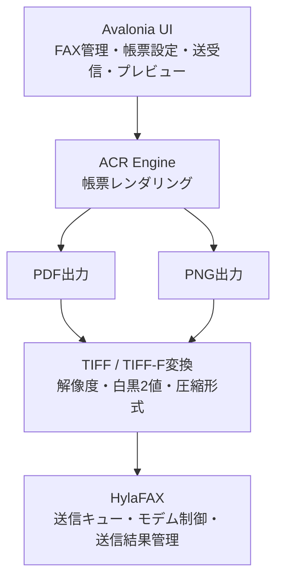

# ACR FAX Server

[English version is here](README.md)

**ACR (Across Report)** が作った帳票や画像を、余計な変換作業なしでそのままFAX送信できるようにする、HylaFAXのプロトコルを直接話す軽量クライアントです。

> **ACRは日々進化し続けています。** このFAX送信の仕組みは意図的にシンプル（PDF/PNGを入れてFAXジョブを出すだけ）に保っており、ACRのレンダリングエンジンに新しい帳票レイアウトや出力形式が加わっても使い続けられるようにしています。

---

## 全体像

`acr_fax_server` はレポートエンジンの出力とHylaFAXの間に位置します。PDFまたはPNGを受け取り、必要に応じてFAX送信可能なTIFFへ変換したうえで、HylaFAX自身のプロトコルでジョブを投入します（`sendfax`/`faxstat` のラップではありません）。

| 入力 | 主な用途 |
|---|---|
| PDF → TIFF | 作成した帳票をFAX送信 |
| PNG → TIFF | 画面キャプチャ・スキャン画像をFAX送信 |

## マルチプラットフォームを見据えた設計

`acr_fax_server` は **Rust** で書かれており、同じソースからWindows・Linux・macOS向けにビルドできます。現時点ではWindows上でビルド・実行しています。

HylaFAX自体はLinux専用なので、HylaFAXの側は必然的にLinuxが必要です。これはこのサーバー自体の移植性とは別の話です。今後の課題として、`acr_fax_server` 自体を **WSL** 上で動かし、HylaFAX以外をWindows1台にまとめられるかを検証する予定です。まだ未検証です。

## 現在の状況

ACRと並行して日々開発・社内実運用中です。Office文書の変換対応は実装済みですが、検証が完了するまで意図的にここには記載していません。

## 関連

- **ACR (Across Report)** — このサーバーが送信する帳票を生成するエンジン
- **ACR FAX Client** — このサーバーを利用するWindowsデスクトップアプリ

## パートナー募集中

このプロジェクトは、私たちだけでは最後まで形にできません。導入連携・販売代理・ハードウェア・実地検証など、様々な形で一緒に取り組んでいただけるパートナーを探しています。**現時点では、まず日本国内のパートナーを対象としています。** ご興味があれば [Issueを立てて](../../issues) ご連絡ください。
