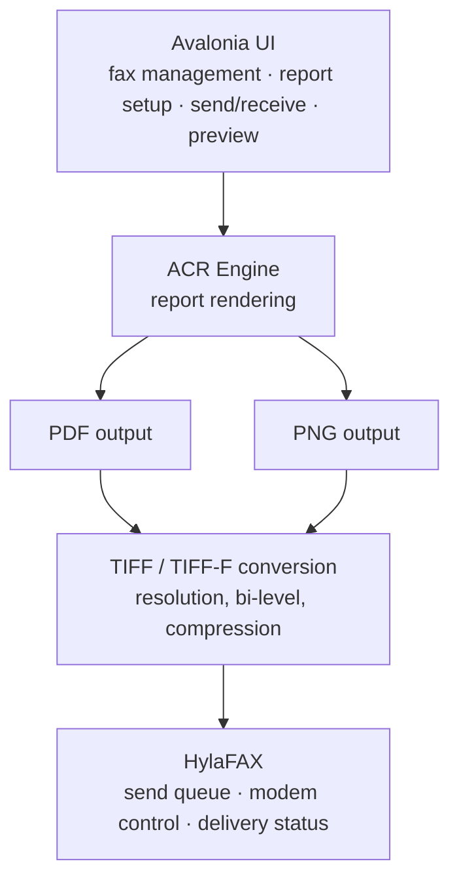

# ACR FAX Server

[日本語版はこちら](README.ja.md)

A small, fast client that speaks the HylaFAX protocol directly, so reports and images produced by **ACR (Across Report)** can go out as a fax without any extra conversion steps on your side.

> **ACR itself changes every day.** The fax pipeline is kept deliberately thin — PDF/PNG in, fax job out — so it keeps working as ACR's rendering engine grows new report layouts and output formats.

---

## How it fits in

`acr_fax_server` is the piece between the output of the report engine and HylaFAX: it takes a PDF or PNG, converts it to a fax-ready TIFF when needed, and submits the job over HylaFAX's own protocol — no `sendfax`/`faxstat` process wrapping involved.

| Input | Typical use |
|---|---|
| PDF → TIFF | Sending a finished report by fax |
| PNG → TIFF | Sending a screen capture / scanned image by fax |

## Cross-platform by design

`acr_fax_server` is written in **Rust**, which builds for Windows, Linux and macOS from the same source. Today it's built and run on Windows.

HylaFAX itself only runs on Linux, so the HylaFAX side of the picture is Linux by necessity — that's separate from this server's own portability. What's on our radar: running `acr_fax_server` itself under **WSL**, so everything but HylaFAX can live on one Windows machine. Not yet verified.

## Status

Actively developed alongside ACR, in day-to-day internal use. Office-document conversion support is implemented upstream but intentionally left undocumented here until it's fully verified.

## Related

- **ACR (Across Report)** — the report engine whose output this server faxes
- **ACR FAX Client** — the Windows desktop app built on top of this server

## Looking for partners

This is ultimately a project we can't carry alone — we're looking for partners to help take it further (integration, distribution, hardware, field testing, you name it). **For now we're focused on partners in Japan.** Interested? [Open an issue](../../issues) and let's talk.
