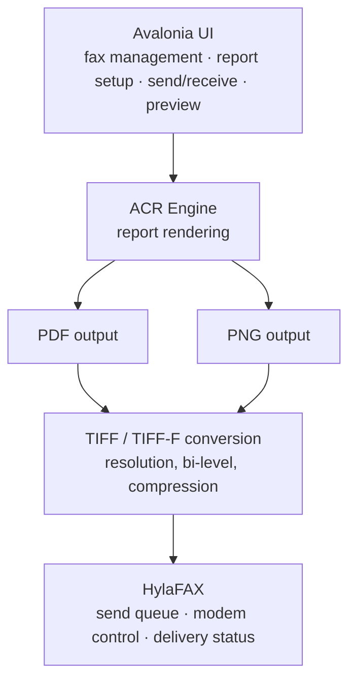

# ACR FAX Server

A small, fast client that speaks the HylaFAX protocol directly, so reports and images produced by **ACR (Across Report)** can go out as a fax without any extra conversion steps on your side.

> **ACR itself changes every day.** The fax pipeline is kept deliberately thin — PDF/PNG in, fax job out — so it keeps working as ACR's rendering engine grows new report layouts and output formats.

---

## How it fits in

`acr_fax_server` is the piece between the output of the report engine and HylaFAX: it takes a PDF or PNG, converts it to a fax-ready TIFF when needed, and submits the job over HylaFAX's own protocol — no `sendfax`/`faxstat` process wrapping involved.

| Input | Typical use |
|---|---|
| PDF → TIFF | Sending a finished report by fax |
| PNG → TIFF | Sending a screen capture / scanned image by fax |

## Status

Actively developed alongside ACR, in day-to-day internal use. Office-document conversion support is implemented upstream but intentionally left undocumented here until it's fully verified.

## Related

- **ACR (Across Report)** — the report engine whose output this server faxes
- **ACR FAX Client** — the Windows desktop app built on top of this server

---

# ACR FAX Server（日本語）

**ACR (Across Report)** が作った帳票や画像を、余計な変換作業なしでそのままFAX送信できるようにする、HylaFAXのプロトコルを直接話す軽量クライアントです。

> **ACRは日々進化し続けています。** このFAX送信の仕組みは意図的にシンプル（PDF/PNGを入れてFAXジョブを出すだけ）に保っており、ACRのレンダリングエンジンに新しい帳票レイアウトや出力形式が加わっても使い続けられるようにしています。

## 全体像

図のとおり、`acr_fax_server` はレポートエンジンの出力とHylaFAXの間に位置します。PDFまたはPNGを受け取り、必要に応じてFAX送信可能なTIFFへ変換したうえで、HylaFAX自身のプロトコルでジョブを投入します（`sendfax`/`faxstat` のラップではありません）。

| 入力 | 主な用途 |
|---|---|
| PDF → TIFF | 作成した帳票をFAX送信 |
| PNG → TIFF | 画面キャプチャ・スキャン画像をFAX送信 |

## 現在の状況

ACRと並行して日々開発・社内実運用中です。Office文書の変換対応は実装済みですが、検証が完了するまで意図的にここには記載していません。
